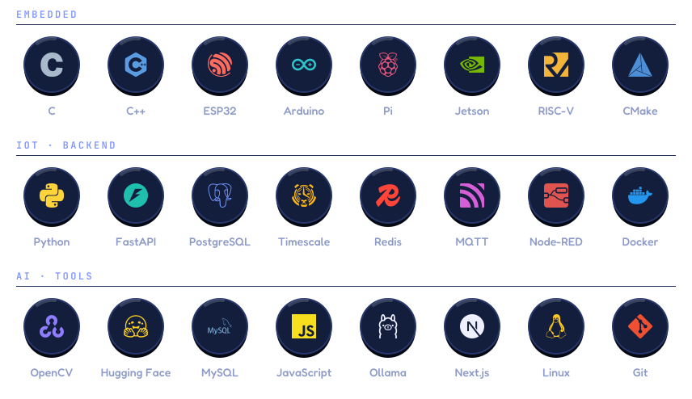
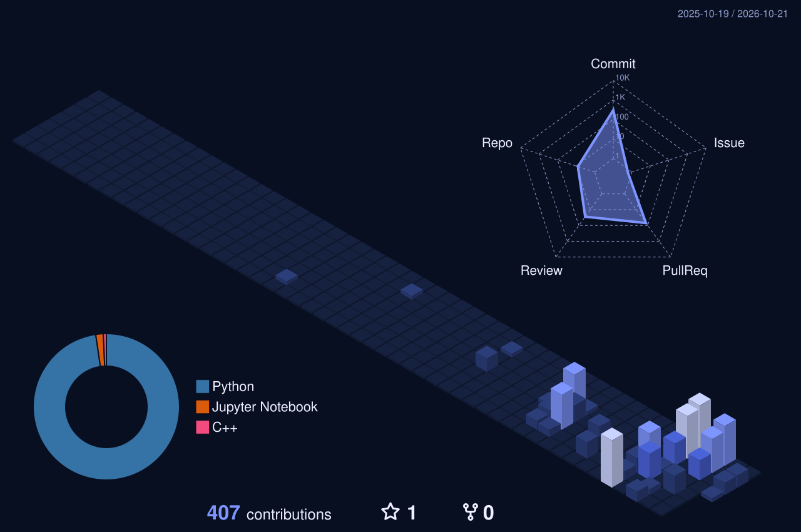

  

  

  

  

  

  

  

| | Project | What it does | Stack |
|---|---|---|---|
| AI | [**rod-mai-rod**](https://github.com/pitchakorn-pkt/rod-mai-rod) | เว็บวางแผนเดินทางในไทยให้ปลอดภัย เช็กอากาศ ณ เวลาที่ไปถึงแต่ละจุด น้ำท่วมจากดาวเทียม มีผู้ช่วย AI แก้ทริปผ่านแชท · [ใช้งานจริง](https://rod-mai-rod.tntproduction.tech) | `FastAPI` `PostgreSQL` `Next.js` `LLM` |
| AI | [**chuayduay**](https://github.com/pitchakorn-pkt/chuayduay) | ผู้ช่วยแก้ปัญหามือถือ/คอมภาษาไทย agentic RAG 8 โมดูล ตอบพร้อมแหล่งอ้างอิง | `FastAPI` `PostgreSQL` `RAG` `Docker` |
| AI | [**SENTINEL-AI**](https://github.com/Mrbeer19/SENTINEL-AI) | security dashboard ที่ให้ LLM ในเครื่องสืบหลักฐานแล้วให้คนอนุมัติการ block (กำลังทำ) | `Python` `Ollama` `React` `SQLite` |
| Vision | [**led-colorwatch**](https://github.com/pitchakorn-pkt/led-colorwatch) | ตรวจจับสี LED เสียผ่านกล้อง + หน้าเว็บ รันได้ทั้ง Win/macOS/Linux | `Python` `OpenCV` |
| Embedded | [**esp32c5-thread**](https://github.com/pitchakorn-pkt/esp32c5-thread) | ESP32-C5 Thread device อ่าน SHT40 ส่งขึ้น MQTT ผ่าน NAT64 + web provisioning | `ESP-IDF` `OpenThread` `MQTT` |
